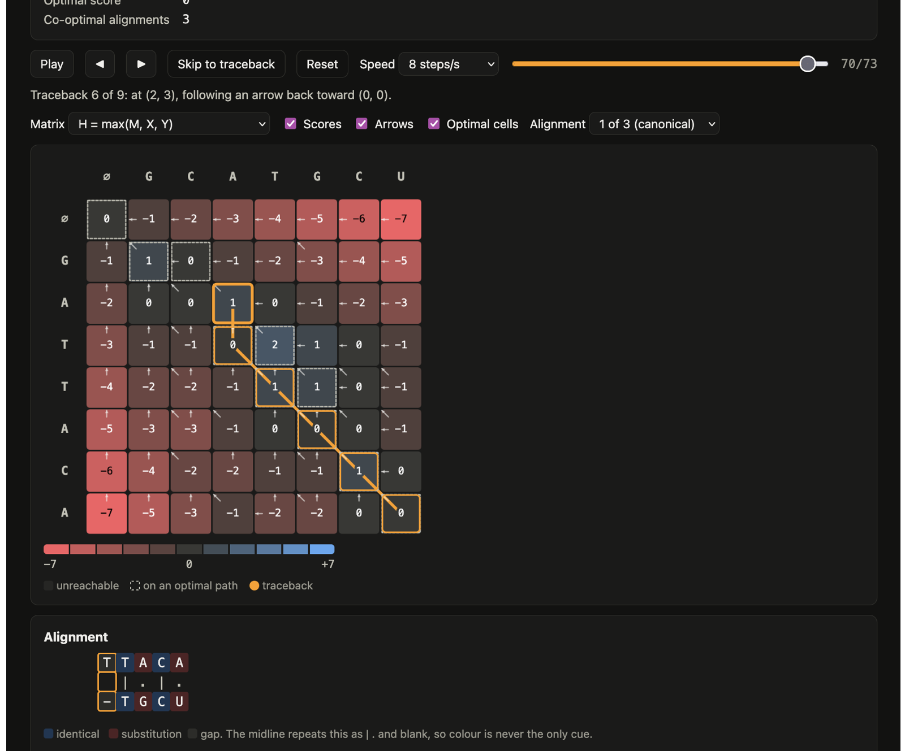

# Bioinformatics DP Engine & Visualizer

Dynamic programming algorithms from computational biology, implemented as tested engines and replayed cell by cell in the browser. The first algorithm, Needleman-Wunsch global alignment, reports not just one optimal alignment but exactly how many there are, and lets you step through any of them.



## What it is 

| Algorithm | Biological question | Engine | Status |
|---|---|---|---|
| [Needleman-Wunsch](docs/algorithms/needleman-wunsch.md) (Gotoh affine gaps) | Are these two sequences related along their full length? | Python | Implemented, tested, visualized |
| Smith-Waterman (Gotoh affine gaps) | Do these sequences share a conserved region? | Java, multithreaded | Planned |
| Nussinov | How might this RNA fold? | Python | Planned |
| Viterbi (CpG island HMM) | Which regions of this DNA are CpG islands? | Java | Planned |

Highlights of the Needleman-Wunsch engine:

* **Every optimal alignment, counted exactly.** Ties are kept rather than discarded. The engine counts co-optimal alignments with arbitrary precision (`A`×200 against `A`×100 has about 9 × 10⁵⁸), lists them lazily, and can sample one uniformly at random.
* **Independently verified.** Expected results come from brute-force enumeration of every possible alignment and from Biopython, never from the engine itself.
* **Two fill kernels, one answer.** A line-by-line reference implementation sits beside a NumPy row-vectorized one, and a property test requires their tables to be bit-identical.
* **Corrected affine-gap handling.** It allows a gap in one sequence directly followed by a gap in the other, a case some aligners get wrong (Flouri et al., 2015). A fixture tests it.

## How it fits together

```
engines (Python, Java)  ->  DPTrace JSON  ->  web visualizer (React + TypeScript)
```

Every engine writes the same trace format, defined once in [`contracts/schemas/dptrace.schema.json`](contracts/schemas/dptrace.schema.json). The browser never computes DP; it replays the trace. Both the Python and TypeScript test suites validate against that one schema, so the two sides cannot drift apart.

```
contracts/      the DPTrace JSON Schema, shared by every language
fixtures/       golden test cases and substitution matrices (BLOSUM50, BLOSUM62)
engines/python/ biodp: scoring models, Needleman-Wunsch, traceback, trace export
web/            the visualizer
scripts/        regenerate golden fixtures and exported traces
docs/           one write-up per algorithm, plus a template for new ones
```

## Run the visualizer

Requires Node.js 20.19+ or 22.12+.

```bash
cd web
npm install
npm run dev          # open the printed URL, usually http://localhost:5173
```

Pick a case from the Trace menu and press Space. Arrow keys step one cell at a time; "Skip to traceback" jumps to path reconstruction. More detail in [`web/README.md`](web/README.md).

## Use the Python engine

Requires Python 3.10+.

```bash
cd engines/python
pip install -e ".[dev]"
```

```python
from biodp.align import needleman_wunsch
from biodp.scoring import GapPenalty, SubstitutionMatrix

dna = SubstitutionMatrix.match_mismatch(1, -1, alphabet="ACGTU")
result = needleman_wunsch("GATTACA", "GCATGCU", matrix=dna, gap=GapPenalty.linear(-1))

result.score            # 0
result.optimal_count    # 3
print(result.best)      # canonical alignment, gaps placed leftmost
```

More examples in [`engines/python/README.md`](engines/python/README.md).

## Tests

```bash
cd engines/python && pytest && mypy      # 116 tests; mypy in strict mode
cd web && npm test && npm run typecheck  # 37 tests; TypeScript strict mode
```

How correctness is established, in detail: [Validation](docs/algorithms/needleman-wunsch.md#7-validation).

## Regenerating data

```bash
python scripts/generate_nw_golden.py   # golden fixtures, from brute force, cross-checked with Biopython
python scripts/export_traces.py        # traces for the visualizer, from the Python engine
```

## License

[MIT](LICENSE)
